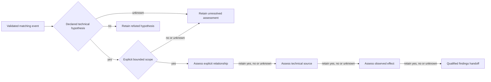

# Evidence-bound positive routes

Working graph **0.20261011b** contains **103 questions and 225 edges**, using unchanged schema **0.20260206e**. Every active question now has a card in the digest-pinned [public evidence criteria](entry-evidence-criteria.json). This is an unpromoted content revision, not a schema change or published standard release. The separate investigation-record candidate remains unchanged.

## What changed

The 13 classification questions previously combined benign behavior, policy violations and maliciousness in one yes/no question, used undefined confidence thresholds, or presumed adversarial intent. Their downstream routes sometimes changed subject or domain without evidence. They now assess **one named, falsifiable technical hypothesis** against a declared criterion, then retain separate scope, relationship, technical-source and observed-effect assessments.

The 42 entry, validation, exclusion and unresolved predicates from [PR #8](https://github.com/TENSOR-Standards-Consortium/TENSOR-Framework/pull/8) retain their wording and routing. Their evidence-card annotations identify this new draft revision. Entry yes continues to mean a matching record, not a malicious event.

| Domain | Primary / independent classification | Corresponding scope | Correlation | Technical source | Observed effect | Findings / refuted / unresolved |
|---|---|---|---|---|---|---|
| Identity | Q233 / Q233 | Q253 / Q253 | Q379 | Q425 | Q492 | Q558 / Q603 / Q596 |
| Host | Q214 / Q221 | Q268 / Q261 | Q348 | Q426 | Q493 | Q559 / Q604 / Q597 |
| Network | Q159 / Q187 | Q303 / Q283 | Q356 | Q439 | Q506 | Q560 / Q605 / Q598 |
| Cloud | Q223 / Q188 | Q256 / Q284 | Q364 | Q440 | Q507 | Q561 / Q606 / Q599 |
| Email | Q161 / Q224 | Q299 / Q257 | Q323 | Q441 | Q508 | Q562 / Q607 / Q600 |
| Application | Q190 / Q225 | Q279 / Q258 | Q345 | Q430 | Q509 | Q563 / Q608 / Q601 |
| File | Q184 / Q219 | Q245 / Q259 | Q346 | Q417 | Q581 | Q588 / Q609 / Q602 |



## Evidence meaning

**Classification:** state the hypothesis, original subjects and interval, operational criterion, discriminating evidence, alternatives and counterevidence. Yes supports only this hypothesis; no contradicts only this hypothesis; unknown retains missing or conflicting evidence. Evaluate multiple hypotheses separately. A file signature, valid login or routine behavior pattern does not establish authorization, policy compliance, benignness or maliciousness. Those broader claims need separately declared criteria and evidence.

**Scope:** retain the original subjects and time interval, cite the validated event, and record entity inclusions, exclusions and unknown dispositions with their bases. The source subject must be included. Unknown related entities may remain explicitly unexamined. This assessment does not claim discovery of the complete affected population. An unsupported scope boundary stops unresolved, preserving the supported hypothesis.

**Correlation:** name the source and target records, target domain and subjects, assessed interval, relation and discriminator. Validate the target's provenance and interpretation. The offline test tool evaluates a shared identifier across separately originating observations; it rejects copies and same-origin observations for this conservative corroboration test. Shared identifiers do not prove causation. Relations to another domain retain the original route context and declare the target context explicitly; they do not silently substitute subjects.

**Attribution:** test a named technical source, such as an effective principal, execution context or writer process, against an assessed discriminator and alternatives. Do not infer human identity, organization or intent from an IP address, recognizable technique, credential or requested agent action. Negative or unknown attribution continues to impact with that limitation retained.

**Impact:** test one named observed metric change, with a comparable baseline and observation, the same metric identity and units, and ordered measurement times inside the bound interval. Yes means this metric changed, not that the event caused the change or that business loss occurred. No means this metric was unchanged on these observations, not that all impact is absent. Missing baselines, exposure-only claims, incompatible units and unknown measurement times remain unknown.

**Endings:** `hypothesis-refuted` preserves the contradicted hypothesis and the validated event. `bounded-findings` means the declared hypothesis and scope are supported and each downstream claim evaluated yes. `partial-findings` preserves a supported hypothesis and scope with one or more negative or unknown relationship/source/effect answers. These names describe the bounded assessment only; even `bounded-findings` can retain unknown scope entities. `unresolved` preserves a material event, hypothesis or scope gap. No ending closes an investigation, authorizes an action or establishes standards conformance.

## Scenarios and limitations

The [scenario suite](scenarios/entry-evidence-cases.json) contains **252 cases**: the seven existing public-report-only cases and 245 synthetic reconstructions. The original public-report cases retain missing victim evidence and end unresolved. New synthetic observations are not attributed to the original incident authors.

All 13 classification nodes exercise yes, no and unknown. Cases cover primary and independent routes, contradicted hypotheses, routine behavior explanations, missing discriminators, subject/time mismatches, incomplete scope, incompatible relation endpoints, copied observations, unknown or contradicted attribution, unchanged metrics, missing baselines, incompatible units and exposure-only claims. Seven cases explicitly relate evidence across domains without changing the source route context.

The tool derives answers from normalized observations and supplied provenance/fact assessments. It tests equality discriminators, shared identifiers and bounded metric comparisons, not arbitrary expressions, native logs or source honesty. The broader evidence cards remain practitioner review criteria; this runner is not a complete implementation of every investigation method. It does not independently authenticate evidence, assess actual policy compliance, infer causal effects, validate authorization, execute tools or test investigation-record Core conformance.

To keep evidence variants reviewable, full base cases are followed by object merge patches referencing earlier case IDs. Null removes a field; arrays/scalars replace. Each derived case declares its own expected path and state. Patches cannot change expectations, reference future cases or create cycles. Input digests cover the exact encoded suite.

## Structural policy and preservation

The repaired graph keeps seven domains, all eight archetypes, acyclicity, reachability, deterministic yes/no/unknown branches, fan-in limits and positive stage progression. It has no cross-domain control-flow edges: evidence relationships can cross domains explicitly while the current hypothesis retains its context. Reconnecting arbitrary questions to hit a quota would defeat the evidence boundary.

The historical 25% cross-domain edge quota remains a blocking error in strict validation and release preparation. Draft-only builds and the existing canonical `--draft-review` mode retain it as a warning. Draft-review also reports its derived routing-score failure as advisory, alongside the prior simulated optimization diagnostics. No threshold or score calculation changed. Six strict gates fail: `cross_domain_pivots`, `routing_score`, `robustness_score`, `targeted_resilience`, `routing_centralization`, and `overall_score`. Original values and failures remain in the [new review receipts](reviews/2026-10-11-positive-evidence/README.md). This is not publication approval; resolving release policy needs an explicit review decision.

Removing unsupported downstream routes detached 88 prior questions. The [exact previous graph](reviews/2026-10-11-positive-evidence/prior-draft.graph.json) preserves their wording and outgoing edges, including every repaired question's prior form. Its [manifest](reviews/2026-10-11-positive-evidence/prior-draft-manifest.json) pins the merged baseline and digest. PR #8's earlier archive and receipts remain unchanged. No published release, schema, manifest, checksum, stable pointer or investigation-record candidate file was changed.

## Reproduce

```sh
python3 scripts/build_core_graph_from_source.py --version 0.20261011b --schema-version 0.20260206e --draft-only
python3 scripts/evaluate_entry_scenarios.py --output /tmp/tensor-positive-scenarios.json
python3 -m unittest discover -s tests/legacy -v
npm run check
python3 scripts/validate_release_contract.py
python3 scripts/lint_core_graph_quality.py --graph-path drafts/core/tensor.core.graph.json --entry-path drafts/core/source/entry_nodes.json --draft-review --output-dir /tmp/tensor-positive-quality
```

Use the repository's pinned Node version. Scenario receipts refuse overwrite; choose a new path on reruns. Omitting `--draft-review` intentionally fails the six documented gates. Review next with independent practitioners and authorized evidence packages; these author-side checks do not establish institutional acceptance or independent interoperability.
